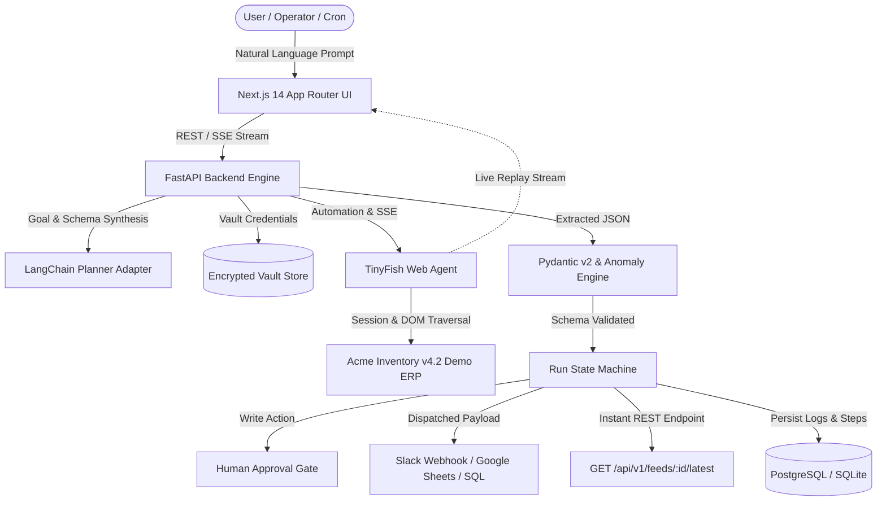

# LegacyBridge 🌉
> **"Describe the task. Keep the old system."**  
> *Built for HackIIITD 2026 by Team Aspirations*

LegacyBridge bridges the gap between ancient legacy portals (ERP, CRM, mainframe wrappers) and modern AI automation. Turn any clunky 2000s web portal into a validated, scheduled REST API and Slack/Sheets feed using natural language, powered by TinyFish Web Agent and LangChain.

---

## 🌟 The Three Trust Pillars
1. **VALIDATE**: Agent completion (`COMPLETED`) does not mean the business goal is met. Output must pass strict Pydantic v2 schemas, row count invariants, null percentage thresholds, and historical drift/anomaly detection.
2. **APPROVE**: Safe-by-default. Read-only extractions run uninterrupted; high-impact mutations (e.g. updating stock reorder levels) trigger a clear before/after diff for human one-click sign-off.
3. **AUDIT**: Cryptographic and immutable history. Every task run records each transition step with timestamps, raw JSON payloads, live TinyFish replay links, and delivery receipts.

---

## 🏗️ Architecture



---

## 🚀 Quickstart (Clean Clone to Live in 2 Minutes)

### Prerequisites
- Node.js >= 18
- Python >= 3.10
- Git

### One-Command Setup & Launch
```bash
# 1. Clone repository
git clone https://github.com/kainturasourav0-star/legacybridge.git
cd legacybridge

# 2. Setup Environment
cp .env.example .env

# 3. Start All Services (Backend, Frontend, Demo ERP)
# Windows PowerShell:
.\scripts\start-all.ps1

# Or run manually in separate terminals:
# Terminal 1: Demo Legacy ERP (Port 8080)
python -m http.server 8080 --directory demo-portal

# Terminal 2: Next.js Full-Stack Application (Port 3000)
npm install && npm run dev

# (Optional) Terminal 3: FastAPI Backend Engine (Port 8000)
uvicorn backend.main:app --reload --port 8000
```

Visit:
- **LegacyBridge Web Console:** [http://localhost:3000](http://localhost:3000)
- **Acme Inventory Demo ERP:** [http://localhost:8080](http://localhost:8080)
- **FastAPI Interactive Docs:** [http://localhost:8000/docs](http://localhost:8000/docs)
- **Instant Feed Endpoint:** [http://localhost:3000/api/feeds/task-q3-sales-acme/latest](http://localhost:3000/api/feeds/task-q3-sales-acme/latest)

---

## 🧪 Running Automated Tests

```bash
# 1. Vitest Unit & Security Test Suite (23 tests)
npm test

# 2. Strict TypeScript Checking & ESLint
npm run typecheck
npm run lint

# 3. Next.js Production Build
npm run build

# 4. Pytest Backend & Validator Suite (11 tests)
python -m pytest backend/tests -v

# 5. PowerShell E2E Smoke Tests (5 user journeys)
powershell -ExecutionPolicy Bypass -File scripts\e2e-smoke-test.ps1
```

---

## 🎯 Demo Mode vs Live Mode
- **DEMO_MODE=true (Default)**: Fully deterministic! TinyFish streaming events, realistic latency pauses, live replay video links, and delivery receipts are simulated faithfully so live stage presentations never fail due to Wi-Fi hiccups.
- **DEMO_MODE=false**: Uses real cloud credentials:
  - `TINYFISH_API_KEY`: Key from `agent.tinyfish.ai`
  - `OPENAI_API_KEY`: For live LangChain schema generation
  - `SLACK_WEBHOOK_URL`: Real channel notifications
  - `DATABASE_URL`: Managed Neon / Supabase PostgreSQL

---

## 📦 Project Structure
```
legacybridge/
├── src/                # Next.js 14 App Router, Tailwind CSS, shadcn/ui, Framer Motion
│   ├── app/            # Task builder, live run console, results explorer, history, feeds
│   ├── components/     # Spline 3D visualizer, navigation, data grid table, diff viewer
│   ├── features/       # Runs console, task library, integrations vault
│   ├── lib/            # TinyFish client, validator, delivery adapters, security & auth
│   └── types/          # TypeScript domain interfaces (Task, Run, ValidationReport)
├── backend/            # FastAPI REST API, LangChain, Pydantic v2, APScheduler, SQLAlchemy
│   ├── adapters/       # TinyFish client, Slack/Sheets/Webhook/Postgres delivery adapters
│   ├── api/            # FastAPI router, SSE stream endpoints, feed cache
│   ├── models/         # SQLAlchemy relational database models
│   ├── services/       # State machine, orchestration engine, Pydantic validator, scheduler
│   └── tests/          # Pytest automated test suite
├── demo-portal/        # Acme Inventory v4.2 (2000s legacy ERP with frames & "Break UI" toggle)
├── supabase/           # PostgreSQL migrations with Row Level Security (RLS) policies
├── docs/               # Architecture PLAN.md, DEMO_SCRIPT.md, design references
└── scripts/            # Startup scripts & automated smoke test suites
```

---

## 🏆 Key Features for HackIIITD 2026
1. **ROI & Time-Saved Meter**: Real-time business savings tracking ($ value & hours).
2. **Break-the-UI Adaptation**: Test the agent by rearranging the legacy ERP's DOM live; the agent adapts without CSS selector brittleness.
3. **Pydantic Validation Engine**: Output must pass type conformity, row-count checks, and null-rate thresholds. Malformed payloads are blocked from delivery.
4. **Approval Gate for Mutations**: Safe-by-default execution. Read-only tasks run automatically; state changes halt for human operator review.
5. **Instant API-ification**: Any legacy web screen automatically exports a clean REST API: `GET /api/v1/feeds/{task_id}/latest`.
6. **Multi-Destination Delivery**: Validated dispatches to Slack, Google Sheets, Generic Webhook (SSRF-protected), and PostgreSQL.

---

## 🗺️ Post-Hackathon Roadmap
- [ ] Multi-tenant enterprise SSO (SAML/Okta) alongside Clerk.
- [ ] Distributed Celery worker clusters on Kubernetes for horizontal scale.
- [ ] Bidirectional forms synchronization for two-way legacy ERP reconciliation.
- [ ] Visual self-healing prompt tuning from failure audit traces.

