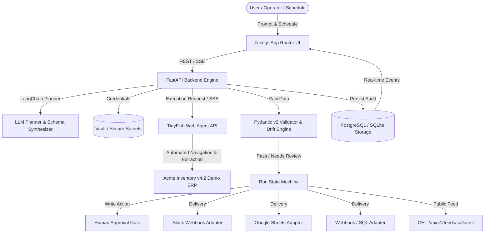

# LegacyBridge — Project Plan & Hackathon Strategy
**HackIIITD 2026 — Team Aspirations**  
*Tagline: "Describe the task. Keep the old system."*

---

## 1. Executive Summary & Value Proposition
Enterprises spend billions running legacy, clunky ERPs, internal inventory portals, and mainframes that lack modern APIs. Migrating off these systems takes years and incurs catastrophic risks.
**LegacyBridge** converts any legacy web portal into a resilient, automated data pipe and API feed using natural language:
1. **Plain-English task formulation** (e.g. *"Open the inventory portal, pull Q3 sales by region, and post the table to #ops-reports"*).
2. **LangChain-powered Planner** decomposes the prompt into an execution goal and strict Pydantic JSON schema.
3. **TinyFish Web Agent** navigates clunky menus, logs in securely with credentials from Vault, handles session state, and extracts structured data.
4. **Pydantic Validation & Quality Checks** enforce trust: "COMPLETED" does not mean "Goal Met" without mathematical & schema verification.
5. **Human-in-the-Loop Approvals** enforce safety: read-only actions proceed automatically; mutations or high-impact actions trigger an approval diff.
6. **Delivery & Feed Hub**: sends structured tables to Slack, Google Sheets, webhooks, or SQL databases, and automatically publishes a live REST API endpoint (`/api/v1/feeds/{task_id}/latest`).
7. **Complete Audit Trail**: every run step, DOM state change, validation verdict, and live session replay is captured immutably.

---

## 2. The Three Trust Pillars (Judging Anchors)
- **VALIDATE**: Agent completion is never assumed correct. Output must pass strict schema validation, row count sanity checks, null percentage limits, and historical drift/anomaly detection.
- **APPROVE**: Safe-by-default. Read actions stream automatically; writes/updates require one-click human review showing before-after diffs.
- **AUDIT**: End-to-end replayability. Every prompt maps to a persistent run step timeline, live replay URL, delivery confirmation receipt, and cryptographic hash of delivered data.

---

## 3. Architecture Overview

---

## 4. 24-Hour Timebox & Milestones

| Milestone | Target Time | Deliverable |
| :--- | :--- | :--- |
| **M0: Planning & Arch** | Hour 0 - 1 | `docs/PLAN.md`, repo layout, architecture decision records. |
| **M1: Monorepo & Core Setup** | Hour 1 - 2 | Next.js, FastAPI, DB setup, environment configs, CI pipeline. |
| **M2: Data Layer & Persistence** | Hour 2 - 3 | SQLAlchemy models (`tasks`, `runs`, `run_steps`, `approvals`, `credentials`), migrations, seed script. |
| **M3: Acme Demo ERP Portal** | Hour 3 - 5 | 2000s ERP with frames, login, pagination, "Break UI" toggle, simulated session expired/MFA. |
| **M4: TinyFish Client & Adapter** | Hour 5 - 7 | Real TinyFish API integration (`/automation/run`, SSE stream, batch) + bulletproof Demo Mode & replay fixtures. |
| **M5: Planner & Validator Engine** | Hour 7 - 10 | LangChain goal+schema generator, Pydantic v2 validation, self-healing retry loop, prompt-injection defense. |
| **M6: Delivery Engine & Feed API** | Hour 10 - 12 | Idempotent Slack webhook adapter, Sheets/Webhook/SQL dispatchers, `/api/v1/feeds/{task_id}/latest`. |
| **M7: Scheduler & Approvals Engine** | Hour 12 - 14 | APScheduler cron/natural language triggers, approval diff workflow, audit log broadcaster. |
| **M8: Modern Enterprise UI** | Hour 14 - 18 | Task Builder, Live Stream Run Timeline, Results/Delivery Receipt, Dashboard ROI, Approvals, Credentials. |
| **M9: Winning Differentiators** | Hour 18 - 20 | Time-saved counter, anomaly detection, UI break recovery showcase, public replay URL. |
| **M10: Testing & Verification** | Hour 20 - 22 | Unit tests for validation/state machine, end-to-end integration tests in demo + real mode. |
| **M11: Deployment & Pitch Polish** | Hour 22 - 24 | Docker Compose, README with architecture diagram, 3-minute demo script & offline failover checklist. |

---

## 5. Risk Assessment & Mitigations

| Risk | Severity | Mitigation Strategy |
| :--- | :--- | :--- |
| **Hackathon Wi-Fi / API Outage** | Critical | Dual-mode architecture: `DEMO_MODE=true` replays deterministic TinyFish SSE telemetry and Mock Slack deliveries with zero latency failures. |
| **Agent scraping hallucination** | High | Pydantic v2 schema enforcement rejects invalid rows; Self-heal loop prompts planner once with error trace to correct extraction. |
| **Prompt injection from legacy DOM** | High | Portal content treated as untrusted text; sanitization pipeline strips imperative commands prior to LLM validation. |
| **State desynchronization on UI** | Medium | Server-Sent Events (SSE) stream state machine events directly with timestamped recovery fallback. |
| **Duplicate delivery on retries** | Medium | Idempotency keys generated per run ID and destination, preventing repeated Slack/Sheet notifications. |

---

## 6. Cut-List (If Time Runs Short)
1. **Google Sheets OAuth**: Fallback to Google Sheets Webhook or mock sheets preview; keep Slack and REST feeds fully active.
2. **Complex SQL Sink**: Fallback to Postgres export and Webhook payload.
3. **Multi-tenant RBAC**: Focus on single-workspace operator experience with clear credentials masking.

---

## 7. Demo Script Strategy (3 Minutes to Win)
- **0:00 - 0:30 (The Problem & Hook)**: Show "Acme Inventory v4.2" — 2004 frameset ERP with no export button, requiring 2 hours of daily manual copy-pasting.
- **0:30 - 1:15 (The Bridge)**: Type natural language prompt into LegacyBridge. LangChain generates the schema. Hit "Run".
- **1:15 - 2:00 (The WOW Moment - Breaking the UI)**: Toggle "Break the UI" in the legacy ERP (DOM selectors change, buttons move). TinyFish still signs in, navigates pagination, and extracts data flawlessly.
- **2:00 - 2:30 (Trust in Action)**: Show Pydantic validation passing, anomaly detection flag, and live Slack notification arriving with formatted markdown table.
- **2:30 - 3:00 (The Enterprise Hero Feature)**: Show `/api/v1/feeds/inventory-q3/latest` returning clean JSON. The 20-year-old legacy portal is now a modern REST API. Show ROI counter ($12,400 / 320 hours saved).
