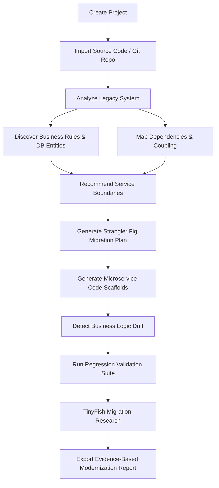

# LegacyBridge — Product Requirements Document (PRD)

## 1. Executive Summary
**LegacyBridge** is an enterprise-grade legacy software intelligence, business logic recovery, and modernization platform. It enables engineering teams, architects, and compliance officers to safely understand undocumented monolithic codebases, discover and verify embedded business logic, plan incremental microservices migrations, detect business logic drift, and validate modernized services against regression suites using verifiable facts and live TinyFish research.

## 2. Problem Statement
Organizations lose institutional knowledge as legacy systems (ERP portals, monolithic backends, undocumented scripts) run critical revenue workflows. Current modernization attempts fail because:
1. **Hidden Business Rules**: Edge cases and calculations are trapped in thousands of lines of legacy code without specifications.
2. **Brittle Architectures**: High coupling and implicit database dependencies make service extraction high-risk.
3. **Logic Drift During Rewrite**: Developers unintentionally alter business rules during microservice migrations, causing catastrophic accounting or compliance discrepancies.
4. **Outdated Migration Guidance**: Teams rely on obsolete blog posts rather than official, version-matched migration documentation.

## 3. Product Principles
- **No Hallucinated Facts**: Static code analysis and deterministic AST parsing extract verifiable ground truths. AI is strictly bounded to semantic explanation and schema-validated suggestions.
- **Evidence-Based Traceability**: Every finding, extracted rule, candidate boundary, and drift detection must cite the exact file path and line numbers.
- **Safe by Default**: Uploaded code is strictly quarantined; execution is isolated and never occurs within standard web request threads.
- **Transparent Provenance**: Distinguish between official vendor documentation (via TinyFish), deterministic test results, AI interpretations, and sample demo data.

## 4. User Journey & Core Workflows

## 5. Functional Requirements by Module

### 5.1 Project & Source Ingestion
- Upload ZIP/TAR source archives with path-traversal validation.
- Select authorized GitHub repositories and branches.
- Provide pre-packaged deterministic demo project ("Acme Order & Loan Legacy Monolith").

### 5.2 Code Intelligence & AST Parsing
- Discover file inventories, languages, entrypoints, and package manifests.
- Extract functions, route handlers, database SQL models, and inter-module calls.
- Catalog findings with Severity (Critical, High, Medium, Low), Category, File, Line, and Remediation.

### 5.3 Interactive Architecture & Dependency Graph
- Interactive canvas displaying Modules, Database Entities, External APIs, and Service Boundaries.
- Visual distinction between detected (static) and inferred (AI) relationships.
- Filter by domain capability, coupling threshold, and dependency depth.

### 5.4 Microservice Boundary Discovery & Migration Planner
- Evaluate module cohesion, coupling scores, data ownership, and transaction boundaries.
- Compare Current-State monolith against Proposed Target Architecture.
- Generate multi-phase Strangler Fig rollout plan with risk register, rollback triggers, and approval gates.

### 5.5 Service Scaffold Generator
- Generate production-ready microservice scaffolds with typed endpoints, Dockerfiles, OpenAPI specs, and domain modules.
- Insert explicit `// TODO: Requires Human Review` tags whenever source logic cannot be deterministically verified.

### 5.6 Business Logic Drift Detector (Flagship)
- Compare original legacy business rules against modernized implementation rules.
- Identify: **MATCH**, **CHANGED**, **MISSING**, or **ADDED** conditions.
- Execute automated regression test cases using permitted inputs and compare observed vs expected outputs.

### 5.7 TinyFish Migration Research Agent
- Server-to-server integration with TinyFish Search (`https://api.search.tinyfish.ai`), Fetch (`https://api.fetch.tinyfish.ai`), and Agent SSE (`https://agent.tinyfish.ai/v1/automation/run-sse`).
- Retrieve official framework migration guides, breaking changes, and prerequisites.
- Cite title, URL, domain, timestamp, and excerpt for every recommendation.

### 5.8 Modernization & Audit Reporting
- Export structured JSON and printable Markdown reports with SHA-256 integrity checksums, test verdicts, and stakeholder approval logs.

## 6. Non-Functional Requirements
- **Performance**: AST parse of 500 files in < 5 seconds; graph rendering < 60fps on modern browsers.
- **Security**: Complete isolation of untrusted archives; Clerk authentication; Supabase Row-Level Security; zero leakage of API secrets to client bundles.
- **Availability**: Offline/demo mode fallback when external credentials are absent.
